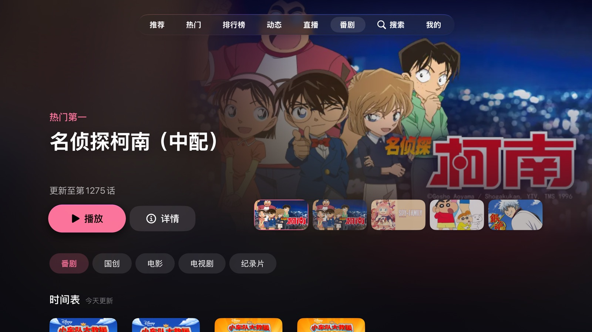
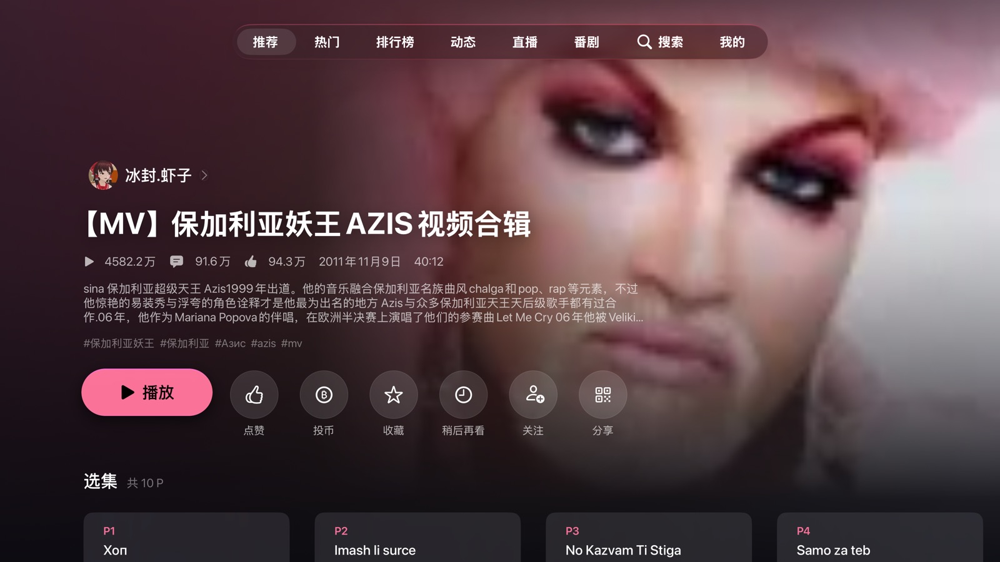
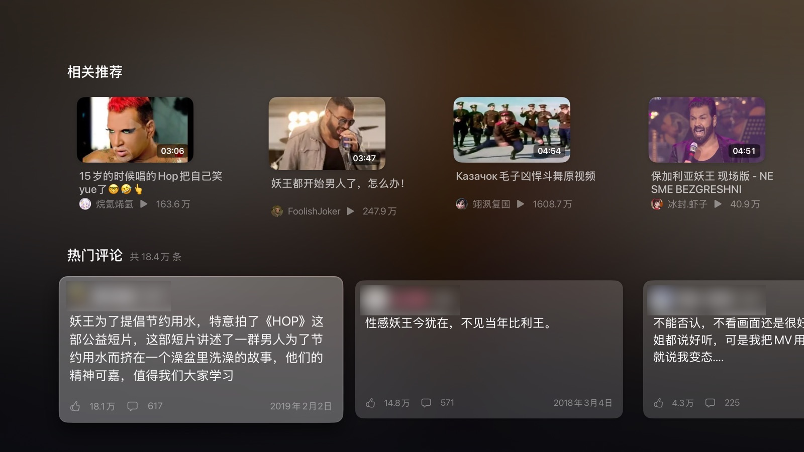
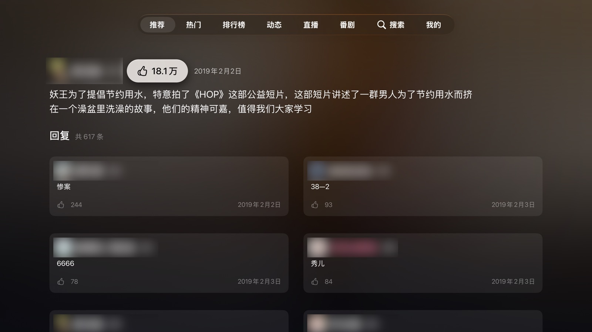
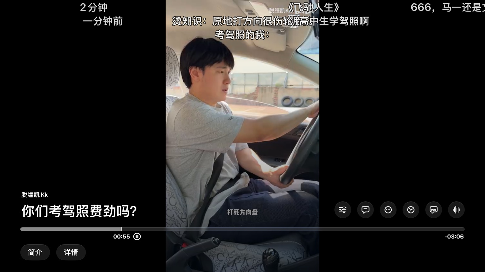
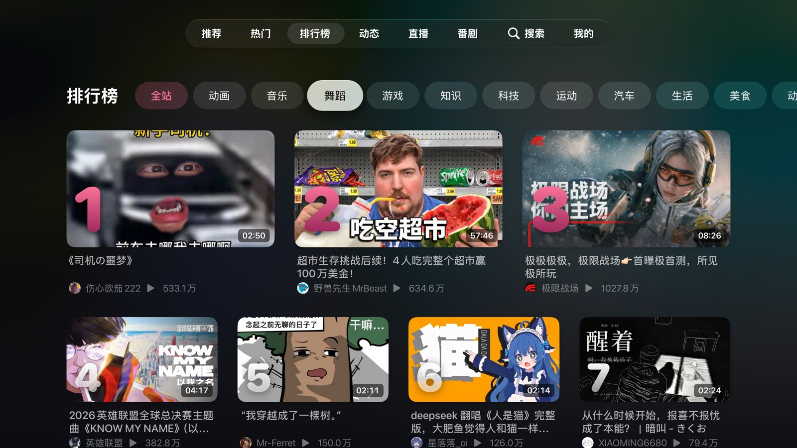
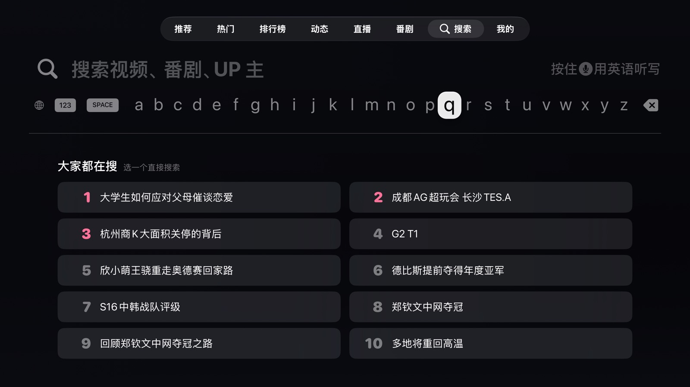

<div align="center">


**An unofficial Bilibili client for Apple TV**

Native tvOS experience · 4K / HDR / Dolby Vision · smooth danmaku · cast from your phone

[](LICENSE)


[](https://github.com/CurryFishBalls9527/DanmuTV/actions/workflows/ci.yml)

[简体中文](README.md) · [Features](#features) · [Screenshots](#screenshots) · [Install](#building-and-installing) · [Disclaimer](#disclaimer)

</div>

> [!IMPORTANT]
> Danmu TV is an **unofficial**, open-source project. It is **not affiliated with, endorsed by, or connected to**
> Bilibili (Shanghai Kuanyu Digital Technology Co., Ltd.). It has **never been published or sold** on the App Store,
> TestFlight or anywhere else, and no prebuilt packages are provided; anyone charging for it is not us.
> **Only install builds you compiled yourself from this repository.** Packages built by others may be tampered with,
> and this app signs in to your Bilibili account.

---

## Features

**Browsing**
- Recommended, Popular, Rankings, Following feed, Live, Anime & series (番剧 / 影视), Search, and My library,
  all built for the Siri Remote
- A full-screen stage on the home page, shelves, infinite scrolling; press ⏯ in a list to refresh
- Anime: popular chart, release schedule, followed series, automatic OP / ED skipping
- Video pages: parts, collections, related videos, **hot comments** with replies and likes
- Long-press a card: watch later, not interested, go to the uploader
- Top Shelf: popular videos and **continue watching**

**Playback**
- Native `AVPlayerViewController`; DASH is turned into HLS on the fly so quality adapts to bandwidth
- 4K / 8K, HEVC / AV1, HDR10 / HLG, Dolby Vision, Dolby Atmos / FLAC
- Dynamic range and frame-rate matching; CDN strategies with automatic fallback
- Resume, autoplay of the next part and of related videos
- **Hold the clickpad for temporary 2× / 3×**; loop, mirror, chapters, subtitles (including AI subtitles)
- Optional sponsor-segment skipping via [BilibiliSponsorBlock](https://github.com/hanydd/BilibiliSponsorBlock)

**Danmaku (bullet comments)**
- CALayer rendering with off-main-thread rasterization; smooth with dense comments on a 1st-gen Apple TV 4K
- Size, opacity, speed, area, density, duplicate merging; filtering by weight, type and keywords, synced with the
  account's block list
- **Person masking**: with Bilibili's own masks, comments pass behind people

**Live**: HLS via AVPlayer and FLV via VLC, live danmaku and Super Chat.

**Cast from your phone**: tap Cast in the official Bilibili app and choose Danmu TV. Danmu TV receives the video's
identity (not just a stream URL), so danmaku, history and quality come from Danmu TV's own player; pause, seek, speed
and stop on the phone are followed. Supports the current UPnP + NirvanaControl flow and the older NVA protocol; plain
media URLs from other DLNA apps play too.

**Also**: QR login, up to 5 accounts synced across Apple TVs via iCloud Keychain, SMB network shares, alternate
app icons, no analytics or crash reporting.

> The interface is Simplified Chinese only for now.

## Screenshots

| Home | Anime |
|---|---|
|  |  |
| **Video page** | **Hot comments** |
|  |  |
| **Comment thread** | **Player** |
|  |  |
| **Rankings** | **Search** |
|  |  |

<sub>Screenshots from the logged-out simulator. Videos, artwork and comments shown belong to their respective owners;
commenters' names and avatars are blurred.</sub>

## Building and installing

Danmu TV isn't on the App Store; build it and install it on your Apple TV yourself.

**You need**
- A Mac with Xcode 26 or later (CI builds with Xcode 26; developed with Xcode 27)
- [XcodeGen](https://github.com/yonaskolb/XcodeGen): `brew install xcodegen`
- An Apple TV on tvOS 17+, on the same network as the Mac
- An Apple ID. With a free account the signature expires after 7 days and App Groups aren't available (set
  `DANMUTV_APP_GROUP = NO` in `Local.xcconfig`; Top Shelf then shows popular videos only). A paid developer account
  lasts a year and enables everything.

```sh
git clone https://github.com/CurryFishBalls9527/DanmuTV.git
cd DanmuTV
cp Config/Local.xcconfig.example Config/Local.xcconfig   # set your team ID and bundle ID
xcodegen generate
open DanmuTV.xcodeproj
```

1. In `Config/Local.xcconfig`, set `DEVELOPMENT_TEAM` (shown in Xcode › Settings › Accounts) and an
   `APP_BUNDLE_ID` of your own, such as `com.yourname.DanmuTV`.
2. On the Apple TV, open Settings › Remotes and Devices › Remote App and Devices, and pair it in Xcode's Devices window.
3. Pick the `DanmuTV` scheme and your Apple TV, then press ⌘R.

To just try it in the simulator, skip steps 1 and 2.

## Known limitations

- Simplified Chinese interface only.
- HDR / Dolby Vision / Atmos and display matching are implemented but verified on few devices; reports welcome.
- Casting works only while Danmu TV is open (tvOS doesn't keep background apps on the network).
- The cast receiver doesn't require pairing: any device on the same network can start, pause or stop playback. Turn
  it off in Settings › 投屏 if you don't need it.
- Person masking needs Bilibili's masks, which only some videos have; quality depends on their data.
- Logged out, Bilibili returns only the top 3 comments.
- The APIs are unofficial and may break when Bilibili changes them.

## Development

```sh
cd Packages/BiliKit && swift test          # unit tests: networking, parsing, signing, danmaku, casting
scripts/sim.sh "danmutv://tab/recommend"    # build and launch muted in the simulator
```

- `Packages/BiliKit`: everything that isn't UI (API, signing, DASH→HLS, danmaku, cast protocols); `swift test` runs on macOS
- `DanmuTV/`: SwiftUI app and player; `TopShelf/`: the Top Shelf extension
- `DanmuTVUITests/`: remote-driven UI tests; they use the live API, so run them deliberately

**Architecture at a glance**

- **Playback**: Bilibili serves DASH (separate fMP4 audio and video). `DashResourceLoader` answers an
  `AVAssetResourceLoader` custom scheme with HLS playlists generated on the fly from the `sidx` indexes, so `AVPlayer`
  gives the native player, adaptive bitrate and HDR / Dolby Vision.
- **Danmaku**: protobuf segments (6 minutes each) are filtered and merged into a timeline; `DanmakuRasterizer` draws
  text into bitmaps off the main thread, and the main thread only moves `CALayer`s. Person masking pre-renders
  Bilibili's SVG masks into small bitmaps used as the danmaku layer's mask.
- **Casting**: while in the foreground, `CastReceiver` announces itself over SSDP and serves both UPnP SOAP
  (AVTransport, NirvanaControl, …) and the older binary NVA protocol on port 9958; the protocol code (frame codec,
  `_nva_ext_` decoding, SOAP) lives in BiliKit with unit tests.

Contributions are welcome; see [CONTRIBUTING.md](CONTRIBUTING.md).

## Disclaimer

- Danmu TV is an independent, **unofficial** open-source project with **no affiliation** with Bilibili or its
  affiliates, and is not authorized or endorsed by them. "哔哩哔哩", "bilibili" and related names and marks belong to
  their owners and are used here only to describe compatibility.
- All videos, anime, live streams, danmaku and comments are copyright of Bilibili and their creators. Danmu TV does not
  host, cache or redistribute any content; it accesses what Bilibili already offers the signed-in user, with that
  user's own account.
- Danmu TV does **not** bypass any paywall, membership, region or copyright restriction, and does not break any DRM.
  Premium (大会员) content requires your own premium account.
- The APIs used are not public and may change or stop working at any time. Using this software may violate
  Bilibili's terms of service; **you use it at your own risk**.
- Third-party clients may trigger Bilibili's risk control and lead to account restrictions or bans. The author is not
  responsible for account problems, data loss or any other damage resulting from using this software.
- Danmu TV is released under GPL-3.0. The author does not sell it or offer any paid version or service; anyone
  charging for it is not connected to the author. We hope it is used for learning and personal use.
- Login credentials stay in your device's Keychain (synced between your own devices if iCloud Keychain is on) and are
  sent only to Bilibili. The project collects no data and has no analytics or crash reporting. The only third-party
  request: with sponsor-segment skipping switched on (off by default), the playing video's BV id is sent to
  [BilibiliSponsorBlock](https://github.com/hanydd/BilibiliSponsorBlock) (bsbsb.top); no account data is included.
- The software is provided "as is", without warranty of any kind; see [LICENSE](LICENSE).
- To interoperate with the official phone app's casting, Danmu TV's UPnP replies on the local network use protocol
  identifiers of the official TV app (package name, manufacturer), and some endpoints require the publicly circulated
  signing parameters of official clients. These are for compatibility only and imply no affiliation; Danmu TV always
  appears as "Danmu TV · …" in device lists.
- If you are a rights holder and believe this project infringes your rights, please email
  [ChaosStudio599@gmail.com](mailto:ChaosStudio599@gmail.com) and we will respond promptly.

## Acknowledgements

- [ATV-Bilibili-demo](https://github.com/yichengchen/ATV-Bilibili-demo), the pioneering open-source Bilibili client for Apple TV
- [NeoBV](https://github.com/b1ackmarket/NeoBV), reference implementation of the current cast flow (MIT)
- xfangfang's [analysis of the "哔哩必连" (NVA) protocol](https://www.xfangfang.cn/028)
- [VLCKit](https://code.videolan.org/videolan/VLCKit), [AMSMB2](https://github.com/amosavian/AMSMB2),
  [BilibiliSponsorBlock](https://github.com/hanydd/BilibiliSponsorBlock)
- Full third-party licenses and notes: [THIRD_PARTY_NOTICES.md](THIRD_PARTY_NOTICES.md)

Developed with the help of [Claude Code](https://claude.com/claude-code).

## License

[GNU General Public License v3.0](LICENSE): you may use, modify and redistribute it, and distributed modified versions
must make their source available under the same license.
